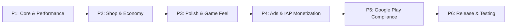

# GALAXY STRIKE — BẢN KHẢO SÁT, ĐÁNH GIÁ & LỘ TRÌNH THƯƠNG MẠI HÓA CH PLAY

> **Mục đích tài liệu:** Bàn giao kỹ thuật toàn diện cho AI / Kỹ sư phần mềm tiếp quản thực thi, tối ưu hóa và đóng gói phát hành dự án **Galaxy Strike** lên Google Play Store (CH Play) thương mại.

---

## 1. TỔNG QUAN DỰ ÁN & MÔI TRƯỜNG KỸ THUẬT

- **Tên dự án:** Galaxy Strike
- **Thể loại:** 2D Top-Down Space Shooter / Shoot 'em up (Arcade SHMUP)
- **Engine:** Unity `2022.3.62f2` (LTS)
- **Render Pipeline:** 2D Built-in Render Pipeline / UGUI / TextMesh Pro
- **Cấu trúc Scene:**
  1. `Assets/Scenes/HomeScene.unity` (Menu chính, chọn tàu, mở shop, chọn chế độ chơi)
  2. `Assets/Scenes/GameScene.unity` (Vòng lặp gameplay chính, chiến đấu, boss, HUD)

---

## 2. HIỆN TRẠNG KIẾN TRÚC & MÃ NGUỒN (AS-IS ANALYSIS)

### 2.1. Core Gameplay & Vòng lặp trận đấu
- **Người chơi (`PlayerController.cs`):**
  - Cơ chế kéo rê cảm ứng / chuột (`ScreenToWorldPoint`) kèm giới hạn biên (`minMoveX`, `maxMoveX`, `minMoveY`, `maxMoveY`).
  - Tự động xả đạn (`HandleShooting`) theo `fireRate`.
  - Hệ thống đạn phân cấp 1 → 5 tia xòe quạt (`bulletLevel`, `bulletSpacing`, `spreadAngle`).
  - Ăn item tăng đạn `PowerUp_Bullet` để tăng cấp hỏa lực.
- **Kẻ địch & Boss (`Enemy.cs`, `BossController.cs`):**
  - 8 loại quái chia cấp độ: `Scout`, `Fighter`, `Striker`, `Gunship`, `Cruiser`, `Destroyer`, `Elite`, `MiniBoss`, `Boss`.
  - Quỹ đạo bay đa dạng: `FormationPatrol`, `StraightDown`, `Zigzag`, `Sweep`, `DiveAtPlayer`, `HoldPosition`, `BossPattern`.
  - Boss có cơ chế chia 3 Phase máu (`phase2Threshold = 0.6f`, `phase3Threshold = 0.25f`), đổi màu sắc, nhân tốc độ đạn và dao động hình Sin.
- **Tiến trình màn chơi (`LevelManager.cs` & `EnemyGridSpawner.cs`):**
  - Thuật toán sinh tự động 50 Level trải dài trên 5 Zone: *Earth Orbit*, *Asteroid Belt*, *Deep Space*, *Alien Void*, *Mothership Core*.
  - Cứ mỗi 5 Level có Mini-Boss, mỗi 10 Level có Boss cực đại.
  - Spawner tự động lấy `LevelData` từ `LevelManager.Instance.GetCurrentLevelData()`, tính tổng máu / quái và bắn sự kiện chiến thắng về `GameManager`.

### 2.2. Giao diện (UI) & Âm thanh (Audio)
- **HUD Trong trận (`HUD_Panel.cs`):** Thanh máu tổng toàn hạm đội địch (Stage HP Bar) trượt mượt mà, thanh máu người chơi dạng Segment, điểm số, số quái còn lại.
- **Pop-up Kết thúc (`VictoryPanelUI.cs`, `GameOverPanelUI.cs`, `SettingsPanelUI.cs`):** Hiển thị thống kê điểm, vàng thưởng, nút Next Level, Replay, Main Menu.
- **Âm thanh (`AudioManager.cs`):** Quản lý BGM (`Intercept_Course.mp3`, `bgm_music.mp3`) và SFX (`shooting`, `explode`, `coin`, `button_click`), kết nối AudioMixer và lưu cài đặt Mute/Volume qua `PlayerPrefs`.

---

## 3. CÁC ĐIỂM NGHẼN & TỒN ĐỌNG CẦN KHẮC PHỤC TRƯỚC KHI LÊN STORE

| Phân hệ | Vấn đề hiện tại | Rủi ro khi lên CH Play |
| :--- | :--- | :--- |
| **Hiệu năng (GC Allocation)** | `Bullet`, `EnemyBullet` và `Enemy` đang dùng `Instantiate()` và `Destroy()` liên tục trong trận. | Gây sụt giảm FPS (GC Spikes) nghiêm trọng trên các máy Android tầm trung và giá rẻ khi đạn bay dày đặc. |
| **Kinh tế & Mua sắm (Shop)** | `ShopItemUI.cs` mới chỉ có `Debug.Log`, chưa trừ tiền, chưa lưu trạng thái sở hữu tàu hay nâng cấp stat tàu. | Game chưa có vòng lặp tiêu tiền (Sink/Faucet), người chơi không có động lực cày cuốc. |
| **Dữ liệu (Data Persistence)** | Dữ liệu bị phân mảnh giữa `PlayerPrefs` và `PlayerDataSO.cs`. | Dễ mất dữ liệu khi update app, dữ liệu lưu thô (plaintext) dễ bị người dùng can thiệp/hack điểm. |
| **Quy chuẩn Google Play (Android)** | `AndroidTargetArchitectures: 1` (chỉ ARMv7 32-bit), `Package Name` đang là `DefaultCompany`, thiếu Keystore. | **Google Play Console sẽ từ chối file build ngay lập tức** (Bắt buộc ARM64 + IL2CPP + file định dạng `.aab`). |
| **Thương mại hóa (Monetization)** | Chưa tích hợp SDK Quảng cáo (AdMob/Unity Ads) và Chưa có In-App Purchase (IAP). | Game không thể sinh doanh thu khi phát hành. |
| **Giữ chân người chơi (Retention)** | Chưa có hệ thống hồi Năng lượng theo thời gian, thiếu Đăng nhập 7 ngày, Nhiệm vụ hằng ngày. | Tỷ lệ giữ chân người chơi ngày 1 (D1) và ngày 7 (D7) sẽ rất thấp. |

---

## 4. LỘ TRÌNH THỰC THI CHI TIẾT (ACTIONABLE ROADMAP FOR AI)



### 🎯 GIAI ĐOẠN 1: TỐI ƯU HIỆU NĂNG & KIẾN TRÚC CORE (P1)
1. **Xây dựng `ObjectPoolManager.cs`:**
   - Tạo Pool generic hoặc Pool chuyên dụng cho:
     - `Bullet` người chơi (tối đa 50 viên cùng lúc)
     - `EnemyBullet` các loại (tối đa 150 viên cùng lúc)
     - `PowerUp_Bullet` và Prefab hiệu ứng nổ / tia lửa
   - Thay thế toàn bộ lệnh `Instantiate` / `Destroy` trong `PlayerController`, `Enemy`, `EnemyBullet` thành cơ chế `GetFromPool()` / `ReturnToPool()`.
2. **Khóa khung hình & Chống tắt màn hình:**
   - Thêm vào script khởi tạo:
     ```csharp
     Application.targetFrameRate = 60;
     Screen.sleepTimeout = SleepTimeout.NeverSleep;
     ```

---

### 🎯 GIAI ĐOẠN 2: HOÀN THIỆN SHOP, NÂNG CẤP & BẢO MẬT DỮ LIỆU (P2)
1. **Hoàn thiện Logic `ShopManager.cs` & `ShopItemUI.cs`:**
   - Kiểm tra số dư `coin` / `gem` của người chơi trước khi mua.
   - Trừ tiền và lưu key `Ship_Unlocked_{index} = 1`.
   - Chuyển trạng thái nút sau khi mua từ "BUY" sang "SELECT" / "EQUIPPED".
2. **Xây dựng Hệ thống Nâng cấp Chỉ số Tàu (Permanent Upgrades):**
   - Cho phép người chơi nâng cấp 4 chỉ số cơ bản của phi thuyền bằng Coin:
     - Cấp Máu tối đa (`MaxHealth`)
     - Tốc độ bắn (`FireRate`)
     - Tốc độ di chuyển (`MoveSpeed`)
     - Sát thương đạn (`Damage`)
3. **Quản lý Dữ liệu Tập trung (`SaveManager.cs`):**
   - Hợp nhất dữ liệu: Coin, Gem, Năng lượng, Cấp độ Level, Cấp độ nâng cấp tàu.
   - Thêm cơ chế tự động hồi 1 Năng lượng mỗi 10–15 phút (tối đa 30) dựa trên `DateTime.UtcNow`.
   - Mã hóa dữ liệu lưu trữ (AES hoặc mã hóa chuỗi JSON) chống sửa file lưu trên Android.

---

### 🎯 GIAI ĐOẠN 3: ĐỘ HOÀN THIỆN THỊ GIÁC & CẢM GIÁC CHƠI "JUICINESS" (P3)
1. **Hiệu ứng Hạt (Particle System VFX):**
   - Vết lửa động cơ (Engine Thruster Trail) gắn sau đuôi phi thuyền người chơi.
   - Hiệu ứng nổ rực lửa khi quái chết (thay vì biến mất đột ngột).
   - Hiệu ứng va chạm đạn tóe tia lửa (Hit Sparks).
2. **Camera Shake & Haptic Feedback:**
   - Tạo script `CameraShake.cs` kích hoạt khi: Người chơi trúng đạn, Boss bị tiêu diệt, hoặc khi ăn item.
   - Rung phản hồi cảm ứng nhẹ (`Handheld.Vibrate()`) khi tàu người chơi bị va chạm.
3. **Cảnh báo Boss (Boss Warning Banner):**
   - Hiệu ứng đèn đỏ nhấp nháy chữ *"WARNING: BOSS APPROACHING!"* kèm còi báo động khi bước vào Wave Boss.

---

### 🎯 GIAI ĐOẠN 4: THƯƠNG MẠI HÓA (ADS & IAP MONETIZATION) (P4)
1. **Google Mobile Ads (AdMob SDK):**
   - **Rewarded Ads (Quảng cáo nhận thưởng):**
     - Hồi sinh tại chỗ khi Game Over (tối đa 1 lần / màn).
     - Nhân đôi vàng thưởng (`x2 Coins`) tại `VictoryPanelUI`.
     - Xem quảng cáo nhận ngay +5 Năng lượng hoặc +50 Gem.
   - **Interstitial Ads (Quảng cáo xen kẽ):**
     - Tự động xuất hiện sau mỗi 2–3 màn chơi (đặt cooldown tối thiểu 180s giữa 2 lần quảng cáo).
2. **In-App Purchasing (Unity IAP / Google Play Billing):**
   - Gói Mua Gem / Coin (Small, Medium, Huge Pack).
   - Gói "Xóa Quảng Cáo" (`Remove Banner & Interstitial Ads`).
   - Gói Mở Khóa Phi Thuyền Huyền Thoại (Special Bundle).

---

### 🎯 GIAI ĐOẠN 5: CHUẨN HÓA CẤU HÌNH XUẤT BẢN GOOGLE PLAY (P5)
AI thực thi cần cập nhật cấu hình file `ProjectSettings/ProjectSettings.asset`:
- **Thông tin nhận diện:**
  - `companyName`: [Tên Studio / Nhà phát triển]
  - `productName`: Galaxy Strike
  - `bundleIdentifier`: `com.[tên_studio].galaxystrike`
- **Cấu hình Build Android bắt buộc theo chính sách Google 2026:**
  - `scriptingBackend`: **IL2CPP** (bắt buộc)
  - `AndroidTargetArchitectures`: **ARMv7 + ARM64** (Bắt buộc hỗ trợ 64-bit)
  - `targetSdkVersion`: **34** (hoặc 35 tùy yêu cầu mới nhất của Google Play)
  - `buildAppBundle`: **true** (Xuất định dạng `.aab`, không nộp `.apk`)
- **Xử lý phím vật lý Android:**
  - Bắt sự kiện phím **Back** trên Android để mở `PauseMenu` hoặc Popup xác nhận thoát game.
- **Tạo Keystore ký ứng dụng:**
  - Tạo file `.keystore` bảo mật có thời hạn 30 năm, lưu giữ an toàn mật khẩu Alias và KeyPass.

---

### 🎯 GIAI ĐOẠN 6: CHÍNH SÁCH GOOGLE PLAY & CHECKLIST PHÁT HÀNH (P6)
1. **Chính sách & Pháp lý:**
   - Thiết lập trang Web lưu trữ **Chính sách quyền riêng tư (Privacy Policy)** bắt buộc để gắn link vào Play Console.
   - Điền biểu mẫu An toàn Dữ liệu (Data Safety Form): Khai báo mục đích thu thập ID quảng cáo (nếu dùng AdMob) và dữ liệu mua hàng (nếu dùng IAP).
2. **Bộ nhận diện thương hiệu Store (ASO Assets):**
   - Icon ứng dụng: `512 x 512 px` (PNG 32-bit, bo góc theo tiêu chuẩn Google Play).
   - Feature Graphic: `1024 x 500 px` (Ảnh bìa ngang quảng bá game).
   - Ảnh chụp màn hình (Screenshots): Tối thiểu 4–8 ảnh dọc chất lượng cao tỷ lệ 16:9 / 19:9.
3. **Quy trình Thử nghiệm đóng (Google Play Closed Testing Policy):**
   - Đối với tài khoản cá nhân đăng ký sau tháng 11/2023: Cần chạy Closed Test với **tối thiểu 20 testers trong 14 ngày liên tục** trước khi được mở quyền đưa lên Production công khai.

---

## 5. HƯỚNG DẪN DÀNH CHO AI THỰC THI (PROMPT GUIDANCE FOR NEXT AGENT)

Khi bàn giao tài liệu này cho AI tiếp theo, hãy sử dụng prompt mẫu sau:

```text
Bạn là Kỹ sư Lập trình Cấp cao Unity (Senior Unity Game Engineer). 
Hãy đọc kỹ bản tài liệu phân tích kỹ thuật của dự án "Galaxy Strike" ở trên.
Nhiệm vụ của bạn là tiếp quản dự án và thực hiện tuần tự theo Lộ trình 6 giai đoạn:
1. Bắt đầu từ GIAI ĐOẠN 1: Tạo ObjectPoolManager cho toàn bộ hệ thống đạn (Bullet & EnemyBullet) và quái vật.
2. Viết mã sạch (Clean Code), tối ưu hiệu năng mobile, có chú thích chi tiết bằng tiếng Việt.
3. Không làm hỏng các logic hiện có của LevelManager (50 màn chơi) và GameManager.
Hãy bắt đầu với Giai đoạn 1 ngay bây giờ!
```
