# HỌC VIỆN CÔNG NGHỆ BƯU CHÍNH VIỄN THÔNG
## CHƯƠNG TRÌNH THIẾT KẾ VÀ PHÁT TRIỂN GAME
### THIẾT KẾ CƠ CHẾ VÀ MÀN CHƠI

# BÀI BÁO CÁO LEVEL DOCUMENTATION
## Galaxy Strike: Galactic Warfare

| Thông tin | Chi tiết |
| :--- | :--- |
| **Giảng viên hướng dẫn:** | **Trần Duy Hiếu** |
| **Lớp:** | **D24CQGA04-B** |
| **Sinh viên thực hiện:** | **Hoàng Trung Hiếu - B24DCGA048** |

**Hà Nội – 2026**

---

# MỤC LỤC

- [I. GIỚI THIỆU GAME](#i-giới-thiệu-game)
  - [1. Thông tin tổng quan](#1-thông-tin-tổng-quan)
  - [2. Concept](#2-concept)
  - [3. Game tồn tại để làm gì?](#3-game-tồn-tại-để-làm-gì)
  - [4. Người chơi có thể làm gì?](#4-người-chơi-có-thể-làm-gì)
  - [5. Goal & Win/Lose State](#5-goal--winlose-state)
- [II. GAMEPLAY CƠ BẢN](#ii-gameplay-cơ-bản)
  - [1. Core Loop](#1-core-loop)
  - [2. Bàn chơi / Không gian chiến trường (Playfield & Enemy Grid)](#2-bàn-chơi--không-gian-chiến-trường-playfield--enemy-grid)
  - [3. Các loại Phi thuyền Kẻ địch xuất hiện trên màn chơi](#3-các-loại-phi-thuyền-kẻ-địch-xuất-hiện-trên-màn-chơi)
  - [4. Hệ thống Hỏa lực & Cấp độ Đạn (Bullet & Firepower)](#4-hệ-thống-hỏa-lực--cấp-độ-đạn-bullet--firepower)
  - [5. Cách điều khiển Phi thuyền (Controls)](#5-cách-điều-khiển-phi-thuyền-controls)
  - [6. Ràng buộc & Giới hạn](#6-ràng-buộc--giới-hạn)
  - [7. Booster & Vật phẩm hỗ trợ](#7-booster--vật-phẩm-hỗ-trợ)
- [III. MECHANICS (50 LEVEL ĐẦU)](#iii-mechanics-50-level-đầu)
- [IV. MỘT SỐ CHỦ ĐỀ CHIẾN TRƯỜNG (THEMES & ZONES VŨ TRỤ)](#iv-một-số-chủ-đề-chiến-trường-themes--zones-vũ-trụ)
- [V. TIẾN TRÌNH 50 LEVEL ĐẦU](#v-tiến-trình-50-level-đầu)
  - [1. Mục tiêu giai đoạn 50 level đầu](#1-mục-tiêu-giai-đoạn-50-level-đầu)
  - [2. Đường cong độ khó (Difficulty Curve)](#2-đường-cong-độ-khó-difficulty-curve)
  - [3. Lịch mở khóa Mechanic](#3-lịch-mở-khóa-mechanic)
  - [4. Lịch mở khóa Booster](#4-lịch-mở-khóa-booster)
  - [5. Các mốc UX & Monetization quan trọng](#5-các-mốc-ux--monetization-quan-trọng)
  - [6. Level Metrics mục tiêu](#6-level-metrics-mục-tiêu)
  - [7. Bảng roadmap chi tiết 50 level](#7-bảng-roadmap-chi-tiết-50-level)
- [VI. CHI TIẾT 10 LEVEL ĐẦU (15 LEVEL ĐẦU)](#vi-chi-tiết-10-level-đầu-15-level-đầu)
  - [1. Bảng thiết kế Level chi tiết](#1-bảng-thiết-kế-level-chi-tiết)
  - [2. Thời gian, độ khó cảm nhận và Reward](#2-thời-gian-độ-khó-cảm-nhận-và-reward)
  - [3. Cách tính Time Set & Reward](#3-cách-tính-time-set--reward)

---

# I. GIỚI THIỆU GAME

## 1. Thông tin tổng quan

| Thuộc tính | Nội dung chi tiết |
| :--- | :--- |
| **Tên chính thức** | **Galaxy Strike** |
| **Thể loại** | Space Shooter / Top-Down Bullet Hell Arcade (Bắn ruồi không gian hiện đại) |
| **Nền tảng** | Mobile (Android / iOS) + PC / WebGL |
| **Đối tượng người chơi** | Người chơi Casual & Mid-core yêu thích thể loại Arcade kinh điển (Galaga, Space Invaders, 1945), mong muốn trải nghiệm cảm giác chiến đấu nhịp độ nhanh, giải trí đã mắt và thỏa mãn phản xạ né đạn. |
| **USP (Điểm độc đáo)** | Đội hình ma trận hạm đội (Grid Fleet System) với chuyển động tuần tra hình Sin, kết hợp thanh Máu tổng của màn chơi (Stage Fleet Health Bar) và cơ chế nâng cấp đạn rẻ quạt cực đại (Penta Overdrive Storm) tạo cảm giác làm chủ hỏa lực ngoạn mục. |
| **Mô hình kinh doanh** | **IAA** (Rewarded Video hồi sinh & nhân đôi coin sau trận thắng; Interstitial Ads sau các mốc level) + **IAP** (Gói Coin nâng cấp hỏa lực, mua Booster, gói loại bỏ quảng cáo No-Ads). |

## 2. Concept.

**Galaxy Strike** là tựa game bắn phi thuyền không gian cuộn cảnh dọc (Vertical Space Shooter). Người chơi sẽ trực tiếp điều khiển một chiến đấu cơ không gian tối tân, di chuyển linh hoạt trên chiến trường để tiêu diệt các đợt (Waves) hạm đội địch đang bay vào dàn trận theo ma trận ô lưới (Grid Matrix).

Mỗi Level là một chiến dịch độc lập với sự kết hợp phong phú giữa số lượng đợt quái, chủng loại chiến hạm ngoài hành tinh, và cách bố trí đội hình. Người chơi cần tập trung hỏa lực để bào mòn thanh máu tổng của màn chơi (**Stage Fleet HP**) trước khi cạn kiệt lượng máu của phi thuyền. Khi toàn bộ hạm đội địch trong màn bị quét sạch hoặc máu tổng của màn chạm mốc 0, chiến dịch hoàn thành và người chơi tiến vào khu vực không gian kế tiếp.

## 3. Game tồn tại để làm gì?

Mang lại cảm giác **thư giãn, xả stress kết hợp hưng phấn kịch tính**: Người chơi được đắm chìm trong không gian chiến trận ngân hà với âm thanh cháy nổ hoành tráng, phản xạ né tránh các chùm đạn đỏ và đòn bổ nhào cảm tử của kẻ địch. 

Mỗi phát đạn bắn trúng đều có phản hồi thị giác tức thì (kẻ địch chớp đỏ nhận sát thương, thanh Stage HP trên đỉnh màn hình tụt dần theo thời gian thực, kẻ địch phát nổ vỡ vụn kèm âm thanh uy lực và rơi tiền vàng), tạo động lực thôi thúc mạnh mẽ: **“Chơi thêm một màn nữa để nâng cấp đạn và chạm trán Siêu Trùm Mẫu Hạm!”**

## 4. Người chơi có thể làm gì?

- **Touch & Drag / Swipe**: Chạm và kéo rê ngón tay để điều khiển phi thuyền luồn lách mượt mà né tránh đạn và tàu địch.
- **Auto-Fire Stream**: Phi thuyền tự động xả đạn liên tục theo chu kỳ, giúp người chơi tập trung tối đa vào kỹ năng định vị né đòn và gom vật phẩm.
- **Collect Power-Ups**: Nhặt các vật phẩm nâng cấp đạn rơi ra từ xác tàu địch để tăng số lượng tia đạn từ 1 tia lên tối đa 5 tia cực đại (Penta Overdrive).
- **Gather Coins**: Nhặt các cọc tiền vàng rơi trên chiến trường để tích lũy tài nguyên mua Booster và nâng cấp phi thuyền.
- **Deploy Boosters**: Sử dụng 4 loại bổ trợ công nghệ cao (Overdrive Surge, Energy Shield, EMP Nuke, Hyper Magnet) để xoay chuyển cục diện nguy hiểm.
- **Defeat Bosses & Clear Waves**: Tiêu diệt hạm đội chỉ huy Mini-Boss và Siêu Chiến Hạm Flagship để chinh phục toàn bộ 50 màn chơi.

## 5. Goal & Win/Lose State

- **Goal**: Tiêu diệt toàn bộ các Wave kẻ địch, hạ cạn kiệt thanh Máu tổng của hạm đội (Stage Fleet HP = 0) để giải phóng vùng không gian.
- **Win**: Dọn sạch toàn bộ số lượng quái quy định hoặc thanh Stage Fleet HP về 0 mà phi thuyền người chơi vẫn còn máu $\rightarrow$ Hoàn thành Level, nhận Coin thưởng và hiển thị Banner chúc mừng để sang màn tiếp theo.
- **Lose**: Phi thuyền người chơi bị trúng đạn hoặc va chạm với tàu địch đến khi cạn kiệt 3 vạch máu (Player HP = 0) $\rightarrow$ Thất bại Level (Game Over Pop-up, có thể xem quảng cáo hoặc dùng Coin để Hồi sinh tiếp tục).

---

# II. GAMEPLAY CƠ BẢN

## 1. Core Loop.

$$\text{Xuất kích (Deploy)} \longrightarrow \text{Né tránh \& Xả đạn} \longrightarrow \text{Nhặt Đạn \& Tiền (Power-Up)} \longrightarrow \text{Quét sạch Đội hình / Hạ Trùm} \longrightarrow \text{Chiến thắng \& Nâng cấp}$$

## 2. Bàn chơi / Không gian chiến trường (Playfield & Enemy Grid)

**Cấu trúc**: Không gian vũ trụ dạng cuộn cảnh dọc chuẩn Mobile tỷ lệ 9:16 (chiều rộng giới hạn $X \in [-2.5, 2.5]$, chiều cao giới hạn $Y \in [-4.5, 4.5]$).

- **Đội hình kẻ địch (Enemy Grid Matrix)**: Ma trận dạng hàng và cột (tối đa 4 hàng x 5 cột) xuất hiện từ đỉnh màn hình và dàn trận theo tọa độ không gian.
- **Ngưỡng an toàn (Safe Patrol Boundary: Min $Y \ge 1.2$)**: Đội hình bay lượn và lắc lư (Sway) ở nửa trên màn hình, dừng lại ở ngưỡng an toàn để không trôi đè lên phi thuyền người chơi ở đáy ($Y = -3.0$).
- **Giao diện HUD & Stage HP Bar**: Đặt cố định ở đỉnh màn hình, hiển thị Tên Màn chơi, Khu vực (Zone), Điểm số, Tiền vàng, và tỷ lệ máu tổng còn lại của hạm đội địch.

*Không gian chiến trường Galaxy Strike: Ma trận kẻ địch tuần tra, thanh Stage HP trên đỉnh và Phi thuyền người chơi ở đáy*

## 3. Các loại Phi thuyền Kẻ địch xuất hiện trên màn chơi

Hệ thống kẻ địch trong Galaxy Strike được chia thành 9 lớp chiến hạm với chỉ số máu, điểm thưởng và vai trò chiến thuật riêng biệt:

| STT | Tên Kẻ địch | HP | Điểm | Coin | Phân lớp | Đặc tính chiến đấu |
| :---: | :--- | :---: | :---: | :---: | :---: | :--- |
| **1** | **Enemy_Scout** | 1 | 100 | 1 | Tier 1 (Light) | Tàu trinh sát tốc độ cao, máu mỏng, dàn hàng mở đầu các wave. |
| **2** | **Enemy_Fighter** | 2 | 150 | 2 | Tier 1 (Light) | Chiến đấu cơ tiêu chuẩn, giữ cự ly đội hình tuần tra ổn định. |
| **3** | **Enemy_Striker** | 2 | 200 | 2 | Tier 1 (Light) | Tàu xung kích cơ động, có xu hướng bứt tốc đánh chặn. |
| **4** | **Enemy_Gunship** | 3 | 300 | 2 | Tier 2 (Medium) | Pháo hạm trang bị súng tự động xả đạn plasma đỏ xuống dưới. |
| **5** | **Enemy_Cruiser** | 5 | 500 | 3 | Tier 2 (Medium) | Tuần dương hạm bọc thép, đóng vai trò khiên chắn cho đội hình. |
| **6** | **Enemy_Destroyer** | 8 | 800 | 5 | Tier 3 (Heavy) | Khu trục hạm hạng nặng, chống chịu nhiều phát bắn liên tiếp. |
| **7** | **Enemy_Elite** | 12 | 1200 | 8 | Tier 3 (Heavy) | Chiến hạm tinh nhuệ, vừa bọc thép vừa làm cận vệ cho chỉ huy. |
| **8** | **Enemy_MiniBoss** | 30 | 3000 | 20 | Commander | Chỉ huy tiểu đoàn xuất hiện ở Wave cuối các màn mốc 5. |
| **9** | **Enemy_Boss** | 75 | 6000 | 50 | Major Boss | Đại Trùm Siêu Mẫu Hạm Flagship xuất hiện tại các màn mốc 10. |

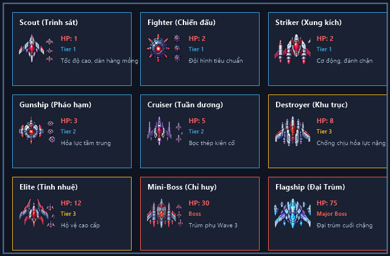

*Bảng tra cứu 9 loại phi thuyền kẻ địch xuất hiện trong Galaxy Strike*

## 4. Hệ thống Hỏa lực & Cấp độ Đạn (Bullet & Firepower)

Phi thuyền của người chơi tự động phun đạn liên tục với chu kỳ xả đạn cực nhanh (`fireRate = 0.15 giây`). Khi tiêu diệt quái, có $15\%$ cơ hội rơi ra vật phẩm tăng đạn (**Power-Up**). Thu thập Power-Up sẽ nâng cấp số lượng tia đạn theo 5 cấp độ hỏa lực:

- **Level 1 (Single Beam)**: 1 tia đạn plasma xanh chính diện, hỏa lực tập trung đơn mục tiêu.
- **Level 2 (Twin Cannons)**: 2 tia song song song hành cách nhau $0.25$ đơn vị, mở rộng độ phủ quét đạn.
- **Level 3 (Triple Spread)**: 3 tia xòe góc cánh quạt nhẹ (từ $-5^\circ$ đến $+5^\circ$), vừa quét thẳng vừa bảo vệ hai bên sườn.
- **Level 4 (Quad Barrage)**: 4 tia hỏa lực mật độ cao (từ $-7.5^\circ$ đến $+7.5^\circ$), xuyên phá nhanh các tốp quái dày đặc.
- **Level 5 (Overdrive Storm)**: 5 tia cực đại xòe góc rộng (từ $-10^\circ$ đến $+10^\circ$), phủ trọn toàn bộ bề ngang màn hình, tối ưu hóa tốc độ dọn dẹp các Wave đông đúc.

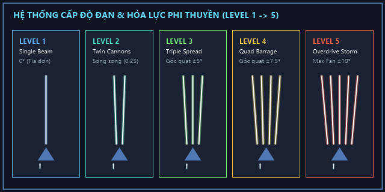

*Sơ đồ 5 cấp độ hỏa lực phi thuyền từ 1 tia đơn đến 5 tia cực đại Fan-Spread*

## 5. Cách điều khiển Phi thuyền (Controls)

- **Touch & Drag (Cảm ứng vuốt)**: Người chơi chạm ngón tay vào màn hình và kéo rê theo hướng mong muốn. Phi thuyền bám sát vị trí chạm theo thời gian thực với độ trễ cực thấp.
- **Nhả tay (Release)**: Khi người chơi nhấc tay khỏi màn hình, phi thuyền dừng ngay tại tọa độ hiện tại.
- **Hỗ trợ Bàn phím (PC / WebGL)**: Hỗ trợ phím $W, A, S, D$ hoặc cụm 4 phím Mũi tên giúp di chuyển linh hoạt trong quá trình thử nghiệm và chơi trên máy tính.
- **Cơ chế Auto-Fire**: Phi thuyền tự động xả đạn liên tục, giải phóng thao tác bấm nút bắn riêng biệt để người chơi rảnh tay tập trung $100\%$ vào phản xạ né đòn.
- **Tránh chạm nhầm UI**: Hệ thống sử dụng cơ chế `IsPointerOverInteractiveUI()` để phân biệt thao tác bấm nút Settings/Pause với thao tác kéo phi thuyền, ngăn ngừa việc gián đoạn chiến đấu vô ý.

## 6. Ràng buộc & Giới hạn

- **Giới hạn không gian bay**: Phi thuyền chỉ được di chuyển trong phạm vi màn hình ($X \in [-2.5, 2.5]$, $Y \in [-4.5, 4.5]$), không thể bay lọt ra ngoài rìa.
- **Giới hạn máu người chơi**: Phi thuyền có tối đa 3 vạch máu (`maxHealth = 3`). Khi trúng đạn hoặc va chạm với địch, mất 1 máu và kích hoạt thời gian bất tử nhấp nháy 1.5 giây (`invulnerabilityDuration = 1.5s`).
- **Giới hạn cấp hỏa lực**: Cấp độ đạn tối đa có thể nâng cấp trong màn chơi là 5 (`maxBulletLevel = 5`).
- **Giới hạn trôi của đội hình**: Đội hình quái chỉ trôi xuống đến ngưỡng an toàn $Y = 1.2$, đảm bảo người chơi luôn có không gian né đạn tối thiểu ở đáy màn hình ($Y = -3.0$).
- **Giới hạn thời gian (Time Limit)**: Mỗi màn chơi có khoảng thời gian quy định (Time Set). Nếu người chơi không hoàn thành việc dọn sạch hạm đội trước khi đồng hồ đếm ngược kết thúc $\rightarrow$ Xử thua (Level Lose).

## 7. Booster & Vật phẩm hỗ trợ

| Tên Booster | Tác dụng chiến thuật | Giá (Coin) |
| :--- | :--- | :---: |
| **Bullet Overdrive** | Tối đa hóa ngay lập tức hỏa lực lên Level 5 (5 tia đạn quạt cực đại) trong suốt màn chơi hiện tại. | **300** |
| **Energy Shield** | Kích hoạt màn chắn năng lượng bất tử trong 5 giây, miễn nhiễm hoàn toàn mọi va chạm và sát thương từ đạn địch. | **350** |
| **EMP Nuke** | Kích nổ bom xung điện từ xóa sạch toàn bộ đạn địch trên màn hình và gây 50 sát thương diện rộng lên toàn bộ hạm đội quái. | **400** |
| **Hyper Magnet** | Tạo trường siêu dẫn tự động hút toàn bộ Coin rơi và hộp vật phẩm Power-Up trên chiến trường về phi thuyền. | **450** |

*Sơ đồ minh họa 4 Booster vũ trụ trong Galaxy Strike*

---

# III. MECHANICS (50 LEVEL ĐẦU)

Hệ thống 6 cơ chế (Mechanics) lõi được giới thiệu tuần tự qua 50 màn chơi, mỗi cơ chế mang lại một lớp thử thách chiến thuật mới giúp duy trì tính bất ngờ và chiều sâu gameplay:

| STT | Mechanic | Text Unlock (in-game) | Mô tả chi tiết | Hình ảnh minh họa |
| :---: | :---: | :---: | :--- | :---: |
| **1** | **Formation Patrol & Sway** *(Unlock Lv 1)* | *“Maintain flight formation! Dodge hostile trajectories and clear the vanguard!”* | Đội hình kẻ địch liên kết thành ma trận ô lưới, lắc lư nhịp nhàng theo chu kỳ hình Sin sang hai bên (trục X) và trôi dần xuống trục Y nhưng dừng lại ở ngưỡng an toàn (min Y = 1.2) để tránh va đè người chơi. | 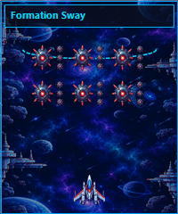 |
| **2** | **Kamikaze Dive Attack** *(Unlock Lv 5)* | *“Warning! Enemy interceptors breaking formation to execute dive runs!”* | Một số phi thuyền Striker bất ngờ tách khỏi ma trận đội hình, bổ nhào cảm tử theo đường cong parabol nhắm thẳng vào vị trí phi thuyền người chơi, buộc người chơi phải phản xạ né tránh khẩn cấp. | 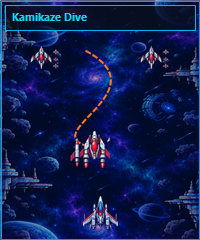 |
| **3** | **Hostile Counter-Fire** *(Unlock Lv 12)* | *“Alert! Enemy vessels are opening fire! Dodge incoming plasma bolts!”* | Các tàu địch từ cấp Gunship trở lên bắt đầu nã các viên đạn plasma đỏ hướng về phía phi thuyền người chơi với tần suất ngẫu nhiên, tạo áp lực vừa bắn vừa luồn lách né đạn. |  |
| **4** | **Heavy Armor Deflector** *(Unlock Lv 21)* | *“Heavy armor detected! High durability vessels require concentrated fire!”* | Các chiến hạm hạng nặng (Destroyer HP 8, Elite HP 12) có lớp giáp phản chấn dày, chớp đỏ mỗi khi bị trúng đạn, không thể bị tiêu diệt bằng 1 phát bắn mà đòi hỏi tập trung hỏa lực liên tục. | 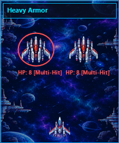 |
| **5** | **Squadron Commander & Escorts** *(Unlock Lv 31)* | *“Commander in sight! Eliminate elite escorts to breach command defenses!”* | Xuất hiện ở Wave 3 của các màn mốc số 5 (Level 5, 15, 25, 35, 45). Gồm 1-2 tàu Mini-Boss (HP 30) đi cùng đội hình hộ vệ tinh nhuệ, vừa xả đạn vừa di chuyển che chắn nhau. | 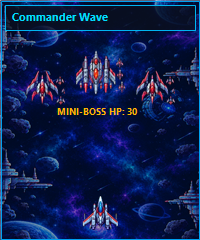 |
| **6** | **Flagship Mega Boss & Stage HP** *(Unlock Lv 41)* | *“Mothership Flagship incoming! Deplete the fleet core HP to secure total victory!”* | Xuất hiện ở các màn Major Boss (Level 10, 20, 30, 40, 50). Siêu chiến hạm Flagship khổng lồ với lượng máu cực lớn (HP 75+), liên kết trực tiếp với thanh Stage Fleet HP ở đỉnh màn hình, xả đạn diện rộng và đòi hỏi kết hợp Booster để hạ gục. |  |

---

# IV. MỘT SỐ CHỦ ĐỀ CHIẾN TRƯỜNG (THEMES & ZONES VŨ TRỤ)

Trong suốt 50 màn chơi, chiến trường được chia thành **5 Chiến Khu Không Gian (Zones)** rộng lớn. Mỗi Zone sở hữu bối cảnh thiên hà đặc trưng cùng các lớp phi thuyền kẻ địch riêng biệt:

### 1. Zone 1: Earth Orbit (Quỹ đạo Trái Đất - Level 1 đến 10)
Chiến trường không gian quỹ đạo quanh Trái Đất với các trạm vệ tinh và trạm nghiên cứu. Kẻ địch chủ yếu là các đội bay trinh sát hạng nhẹ (Scout, Fighter, Striker).

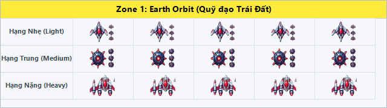

### 2. Zone 2: Asteroid Belt (Vành đai Tiểu hành tinh - Level 11 đến 20)
Chiến trường nguy hiểm với mật độ thiên thạch dày đặc. Kẻ địch bắt đầu triển khai các pháo hạm vũ trang tầm trung (Fighter, Striker, Gunship) xả đạn cản đường.

### 3. Zone 3: Deep Space (Không gian sâu thẳm - Level 21 đến 30)
Khu vực tinh vân tối tăm cách xa hệ mặt trời. Hạm đội địch xuất hiện các tuần dương hạm bọc thép kiên cố (Striker, Gunship, Cruiser) với lớp giáp dày dặn.

### 4. Zone 4: Alien Void (Vực thẳm Ngoại tộc - Level 31 đến 40)
Căn cứ tiền tiêu của người ngoài hành tinh với các cổng dịch chuyển hư không. Kẻ địch huy động các khu trục hạm hạng nặng (Gunship, Cruiser, Destroyer) có khả năng chịu đựng hỏa lực cao.

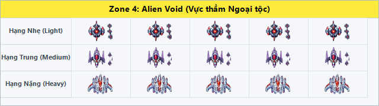

### 5. Zone 5: Mothership Core (Lõi Mẫu hạm Tối thượng - Level 41 đến 50)
Đầu não hạm đội địch bên trong lòng siêu mẫu hạm mẹ. Các chiến hạm tinh nhuệ bọc thép hạng nặng (Cruiser, Destroyer, Elite) cùng các đại trùm Flagship bảo vệ lò phản ứng trung tâm.

---

# V. TIẾN TRÌNH 50 LEVEL ĐẦU

## 1. Mục tiêu giai đoạn 50 level đầu

- Giới thiệu tuần tự 6 Mechanic lõi và 4 loại Booster vũ trụ; mỗi lần chỉ mở khóa 1 yếu tố mới để người chơi kịp làm quen và thuần thục kỹ năng né đạn trước khi đối mặt thử thách mới.
- Đổi mới bối cảnh Zone định kỳ sau mỗi 10 Level để tạo cảm giác “hành trình viễn chinh ngân hà” hấp dẫn, mở rộng dần quy mô chiến sự từ Quỹ đạo Trái Đất tới Lõi Mẫu Hạm.
- Bố trí các mốc tặng thưởng ưu đãi (x2 Coin, tặng 15 phút Bất tử vô hạn mạng) ngay tại các điểm khó (ngay trước hoặc sau các màn Hard / Super Hard) nhằm giảm tỷ lệ người chơi rời bỏ game (churn rate).

## 2. Đường cong độ khó (Difficulty Curve)

Độ khó trong 50 level đầu được thiết kế theo mô hình **“Răng cưa tăng tiến” (Sawtooth Curve)**:
- **Easy**: Chiếm phần lớn số level, đóng vai trò tạo nhịp điệu thư giãn, giúp người chơi làm quen với bố cục đội hình và nâng cấp đạn.
- **Hard**: Xuất hiện định kỳ tại các mốc Level **14, 24, 34, 44** đóng vai trò “mốc kiểm tra kỹ năng và phản xạ né đạn”.
- **Super Hard / Major Boss**: Xuất hiện tại các mốc cuối chặng **10, 19, 20, 29, 30, 39, 40, 49, 50** đóng vai trò “cao trào cảm xúc” với sự góp mặt của các Siêu Trùm Flagship hoặc hạm đội đông đảo trước khi chuyển sang Zone mới.
- **Medium**: Bắt đầu xuất hiện xen kẽ ở nửa sau (Level **41, 45, 48, 50**) để làm mềm nhịp độ trước khi bước vào các màn đại chiến cuối cùng.

| Mốc độ khó | Các level tiêu biểu | Vai trò chiến lược |
| :---: | :---: | :--- |
| **Hard** | **14, 24, 34, 44** | Mốc kiểm tra phản xạ né đạn sau mỗi 10 level, không quá khắc nghiệt. |
| **Super Hard** | **10, 19, 20, 29, 30, 39, 40, 49, 50** | Cao trào của mỗi chặng, trận đại chiến trước khi đổi Zone hoặc chạm trán Boss. |
| **Medium** | **41, 45, 48, 50** | Làm mềm nhịp độ khó ở nửa sau, chuẩn bị tâm lý người chơi vượt ải. |

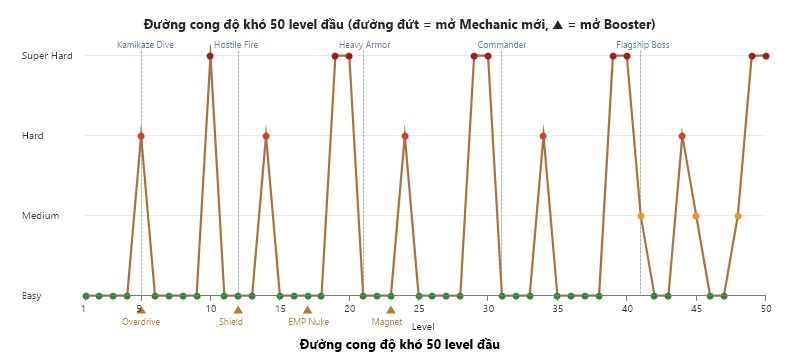

*Biểu đồ đường cong độ khó 50 level đầu của Galaxy Strike*

## 3. Lịch mở khóa Mechanic

| Level | Mechanic mới mở khóa | Text Unlock (in-game) |
| :---: | :--- | :--- |
| **1** | **Formation Patrol & Sway** | *“Maintain flight formation! Dodge hostile trajectories and clear the vanguard!”* |
| **5** | **Kamikaze Dive Attack** | *“Warning! Enemy interceptors breaking formation to execute dive runs!”* |
| **12** | **Hostile Counter-Fire** | *“Alert! Enemy vessels are opening fire! Dodge incoming plasma bolts!”* |
| **21** | **Heavy Armor Deflector** | *“Heavy armor detected! High durability vessels require concentrated fire!”* |
| **31** | **Squadron Commander & Escorts** | *“Commander in sight! Eliminate elite escorts to breach command defenses!”* |
| **41** | **Flagship Mega Boss & Stage HP** | *“Mothership Flagship incoming! Deplete the fleet core HP to secure total victory!”* |

## 4. Lịch mở khóa Booster

| Level | Booster mở khóa | Tác dụng tóm tắt |
| :---: | :--- | :--- |
| **5** | **Bullet Overdrive (#1)** | Tối đa hóa tức thì hỏa lực lên 5 tia đạn quạt cực đại. |
| **12** | **Energy Shield (#2)** | Kích hoạt khiên bảo vệ bất tử trong 5 giây. |
| **17** | **EMP Nuke (#3)** | Xóa sạch toàn bộ đạn địch và gây 50 sát thương toàn màn hình. |
| **23** | **Hyper Magnet (#4)** | Tự động hút toàn bộ Coin và Power-Up trên chiến trường. |

## 5. Các mốc UX & Monetization quan trọng

- **Level 14**: Thắng level nhận phần thưởng **x2 Coin (116 coin)** – đặt ngay trước khi chuyển sang các hạm đội bọc thép dày hơn ở Zone 2, tạo động lực mạnh mẽ để người chơi vượt qua level Hard đầu tiên.
- **Level 19**: Tặng ưu đãi **Unlimited Life 15 phút** – phần thưởng an ủi ngay sau trận chiến Super Hard căng thẳng, giải tỏa ức chế và giảm tỷ lệ người chơi từ bỏ game (churn) ở điểm khó nhất từ đầu game.
- **Level 20**: Xuất hiện **Quảng cáo Interstitial (quảng cáo xen kẽ) đầu tiên** – đặt ngay sau mốc ưu đãi ở Level 19 khi người chơi đang có cảm xúc tích cực và thiện cảm cao với game, giảm thiểu tối đa cảm giác khó chịu.
- **Level 50**: Ghi chú thiết kế nội bộ: *“Trận đấu Boss Mẫu hạm cuối cùng có độ khó cao, cần tổ chức playtest kỹ lưỡng nhịp độ nhả đạn và thời gian hồi sinh để tối ưu hóa tỷ lệ chuyển đổi IAP gói hỗ trợ.”*

## 6. Level Metrics mục tiêu

| Độ khó | Win rate lượt đầu mục tiêu | Churn tối đa chấp nhận tại level |
| :---: | :---: | :---: |
| **Easy** | $85\% - 95\%$ | $\le 3\%$ |
| **Medium** | $65\% - 75\%$ | $\le 5\%$ |
| **Hard** | $45\% - 55\%$ | $\le 8\%$ |
| **Super Hard** | $30\% - 40\%$ | $\le 8\%$ *(Có gói quà an ủi tặng mạng ở Level 19)* |

## 7. Bảng roadmap chi tiết 50 level

| Level | Difficulty | Coin thưởng | Sự kiện / Ghi chú thiết kế |
| :---: | :---: | :---: | :--- |
| **1** | Easy | 32 | Mở đầu chiến dịch Zone 1: Earth Orbit. Làm quen kéo phi thuyền và bắn đạn 1 tia. |
| **2** | Easy | 34 | Đội hình 2x3 quái Scout. |
| **3** | Easy | 36 | Giới thiệu quái Fighter tiêu chuẩn. |
| **4** | Easy | 38 | Đội hình 3x4 mở rộng. |
| **5** | Hard | 105 | **Mở Booster #1 – Bullet Overdrive**; Mở Mechanic #2 – Kamikaze Dive Attack; Mini-Boss #1. |
| **6** | Easy | 42 | Thực hành hỏa lực 3 tia sau khi mở Overdrive. |
| **7** | Easy | 44 | Đội hình 3 wave quái cơ động. |
| **8** | Easy | 46 | Pháo hạm Gunship xuất hiện hỗ trợ đội hình. |
| **9** | Easy | 48 | Đội hình tuần tra dày đặc chuẩn bị cho trận Boss đầu tiên. |
| **10** | Super Hard | 250 | **Trận đại chiến Flagship Boss đầu tiên của Zone 1**; Hoàn thành Quỹ đạo Trái Đất. |
| **11** | Easy | 52 | **Chuyển sang Zone 2: Asteroid Belt**; Bối cảnh vành đai tiểu hành tinh. |
| **12** | Easy | 54 | **Mở Booster #2 – Energy Shield**; Mở Mechanic #3 – Hostile Counter-Fire. |
| **13** | Easy | 56 | Tuần dương hạm Cruiser bọc thép xuất hiện. |
| **14** | Hard | 116 | **Mốc kiểm tra kỹ năng chặng 1 – Thắng level nhận x2 Coin**. |
| **15** | Easy | 155 | Mini-Boss #2 – Đội hình chỉ huy tiểu đoàn có hộ vệ tinh nhuệ. |
| **16** | Easy | 62 | Mật độ đạn địch tăng nhẹ. |
| **17** | Easy | 64 | **Mở Booster #3 – EMP Nuke**. |
| **18** | Easy | 66 | 3 wave quái hỗn hợp Gunship và Cruiser. |
| **19** | Super Hard | 120 | **Cao trào chặng 2 – Sau khi thắng tặng 15 phút Unlimited Life**. |
| **20** | Super Hard | 350 | **Đại chiến Boss Zone 2**; Xuất hiện quảng cáo Interstitial đầu tiên sau khi thắng. |
| **21** | Easy | 72 | **Chuyển sang Zone 3: Deep Space**; Mở Mechanic #4 – Heavy Armor Deflector. |
| **22** | Easy | 74 | Thực hành bắn tập trung vào quái giáp dày. |
| **23** | Easy | 76 | **Mở Booster #4 – Hyper Magnet**. |
| **24** | Hard | 90 | Mốc kiểm tra kỹ năng né đạn trong không gian sâu thẳm. |
| **25** | Easy | 205 | Mini-Boss #3 – Chỉ huy tiểu đoàn Zone 3. |
| **26** | Easy | 82 | Quái Cruiser và Destroyer phối hợp. |
| **27** | Easy | 84 | Đội hình 4 wave với nhịp độ dồn dập. |
| **28** | Easy | 86 | Các đợt bổ nhào cảm tử liên tiếp. |
| **29** | Super Hard | 120 | Đội hình hộ vệ hạng nặng trước Boss. |
| **30** | Super Hard | 450 | **Đại chiến Boss Zone 3: Deep Space Mothership**. |
| **31** | Easy | 92 | **Chuyển sang Zone 4: Alien Void**; Mở Mechanic #5 – Squadron Commander. |
| **32** | Easy | 94 | Không gian vực thẳm ngoại tộc với cổng dịch chuyển. |
| **33** | Easy | 96 | Đội hình Destroyer bọc thép hạng nặng. |
| **34** | Hard | 90 | Mốc kiểm tra kỹ năng chặng 4. |
| **35** | Easy | 255 | Mini-Boss #4 – Đội chỉ huy Alien Void. |
| **36** | Easy | 102 | Hỏa lực dày đặc của các pháo hạm tinh nhuệ. |
| **37** | Easy | 104 | Quái Elite xuất hiện hộ tống đội hình. |
| **38** | Easy | 106 | 4 wave quái dồn dập với tốc độ bay nhanh. |
| **39** | Super Hard | 120 | Trận đánh chặn quy mô lớn của hạm đội Alien. |
| **40** | Super Hard | 550 | **Đại chiến Boss Zone 4: Void Dreadnought**. |
| **41** | Medium | 112 | **Chuyển sang Zone 5: Mothership Core**; Mở Mechanic #6 – Flagship Boss & Stage HP. |
| **42** | Easy | 114 | Tiến sâu vào lõi hạm đội mẫu hạm. |
| **43** | Easy | 116 | Hệ thống phòng thủ tự động dày đặc. |
| **44** | Hard | 90 | Mốc kiểm tra kỹ năng cuối cùng trước trận chung kết. |
| **45** | Medium | 305 | Mini-Boss #5 – Vệ binh tối cao bảo vệ lò phản ứng. |
| **46** | Easy | 122 | Các đợt quái cảm tử bảo vệ đầu não. |
| **47** | Easy | 124 | Toàn bộ các chủng loại quái tinh nhuệ xuất hiện cùng lúc. |
| **48** | Medium | 126 | Làm mềm nhịp độ trước trận chiến tối thượng. |
| **49** | Super Hard | 120 | Hộ vệ hạm đội tối thượng trước đại trùm. |
| **50** | Super Hard | 750 | **Trận đại chiến cuối cùng: Phá hủy Lõi Mẫu Hạm Mothership Core** (Playtest cân bằng độ khó). |

---

# VI. CHI TIẾT 10 LEVEL ĐẦU (15 LEVEL ĐẦU)

## 1. Bảng thiết kế Level chi tiết

Bảng dưới đây trình bày chi tiết thông số thiết kế, cấu hình wave, thời gian và hình ảnh minh họa bố cục màn chơi cho 15 level đầu tiên của Galaxy Strike:

| Level | Difficulty | Note | Mechanic | Time Set (s) | Time Solve (s) | Reward (coin) | Loại Grid | Số lượng Quái | Theme / Zone | Các loại Quái | Cấp Đạn | Hình ảnh minh họa |
| :---: | :---: | :---: | :---: | :---: | :---: | :---: | :---: | :---: | :---: | :---: | :---: | :---: |
| **1** | Easy | Hướng dẫn kéo tàu | Formation Patrol | 60 | 20 | 32 | 2x2 | 4 | Earth Orbit | Scout | Cấp 1 | 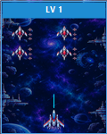 |
| **2** | Easy | Làm quen nhặt đạn | Không | 75 | 25 | 34 | 2x3 | 6 | Earth Orbit | Scout, Fighter | Cấp 1–2 | 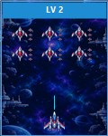 |
| **3** | Easy | Hỏa lực mở rộng | Không | 90 | 30 | 36 | 2x4 | 8 | Earth Orbit | Fighter | Cấp 2 | 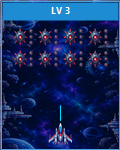 |
| **4** | Easy | Tăng mật độ quái | Không | 105 | 35 | 38 | 3x4 | 12 | Earth Orbit | Striker | Cấp 2 | 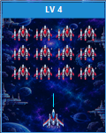 |
| **5** | Hard | Mở Booster #1 | Kamikaze Dive | 120 | 60 | 105 | 3 Waves | 16 | Earth Orbit | Fighter, MiniBoss | Cấp 3 | 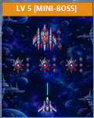 |
| **6** | Easy | Thực hành né đạn | Không | 115 | 55 | 42 | 3x3 (3w) | 14 | Earth Orbit | Striker | Cấp 3 |  |
| **7** | Easy | Quái bổ nhào | Dive Attack | 125 | 60 | 44 | 3x4 (3w) | 16 | Earth Orbit | Gunship | Cấp 3 | 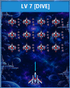 |
| **8** | Easy | Pháo hạm hỗ trợ | Không | 130 | 65 | 46 | 3x4 (3w) | 18 | Earth Orbit | Gunship | Cấp 3 | 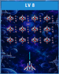 |
| **9** | Easy | Tuần dương bọc thép | Không | 135 | 70 | 48 | 3x4 (3w) | 18 | Earth Orbit | Cruiser | Cấp 3–4 | 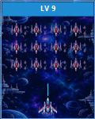 |
| **10** | Super Hard | Đại chiến Boss 1 | Flagship Boss | 160 | 95 | 250 | Boss Wave | 21 | Earth Orbit Boss | Vanguard, Boss | Cấp 4 | 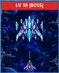 |
| **11** | Easy | Chuyển Zone 2 | Không | 130 | 65 | 52 | 3x4 (3w) | 16 | Asteroid Belt | Striker | Cấp 3–4 |  |
| **12** | Easy | Mở Booster #2 | Hostile Fire | 135 | 65 | 54 | 3x4 (3w) | 18 | Asteroid Belt | Gunship | Cấp 4 | 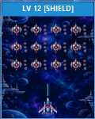 |
| **13** | Easy | Giáp dày hơn | Không | 140 | 70 | 56 | 3x4 (3w) | 20 | Asteroid Belt | Cruiser | Cấp 4 |  |
| **14** | Hard | Thắng x2 coin | Không | 145 | 110 | 116 | 3x4 (3w) | 22 | Asteroid Belt | Destroyer | Cấp 4–5 | 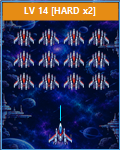 |
| **15** | Easy | Mini-Boss #2 | Heavy Armor | 150 | 75 | 155 | Commander | 16 | Asteroid Belt | Elite, MiniBoss | Cấp 4–5 |  |

## 2. Thời gian, độ khó cảm nhận và Reward

Bảng dưới bổ sung các thông số chi tiết cho từng level: thời gian đặt tối đa (Time Set), thời gian giải quyết kỳ vọng của người chơi trung bình (Time Solve), cảm nhận độ khó và lượng Coin phần thưởng nhận được:

| Level | Difficulty | Ma trận Grid | Tổng số Quái | Time Set (s) | Time Solve (s) | Feeling độ khó cảm nhận | Reward (Coin) |
| :---: | :---: | :---: | :---: | :---: | :---: | :--- | :---: |
| **1** | Easy | 2x2 | 4 | 60 | 20 | Rất dễ – Làm quen thao tác kéo phi thuyền và bắn đạn. | 32 |
| **2** | Easy | 2x3 | 6 | 75 | 25 | Rất dễ – Làm quen nhặt vật phẩm Power-Up tăng đạn. | 34 |
| **3** | Easy | 2x4 | 8 | 90 | 30 | Dễ – Thỏa mãn cảm giác hỏa lực 2 tia quét sạch hàng quái. | 36 |
| **4** | Easy | 3x4 | 12 | 105 | 35 | Dễ – Đội hình đông hơn, nhịp độ bắn tăng nhẹ. | 38 |
| **5** | Hard | 3 Waves | 16 | 120 | 60 | Khó vừa – Chạm trán Mini-Boss đầu tiên, cần né đòn bổ nhào. | 105 |
| **6** | Easy | 3x3 | 14 | 115 | 55 | Dễ – Thư giãn với cấp đạn 3 tia vừa nâng cấp. | 42 |
| **7** | Easy | 3x4 | 16 | 125 | 60 | Dễ – Làm quen với cơ chế quái tách hàng bổ nhào cảm tử. | 44 |
| **8** | Easy | 3x4 | 18 | 130 | 65 | Dễ vừa – Pháo hạm bắt đầu bắn trả rải rác. | 46 |
| **9** | Easy | 3x4 | 18 | 135 | 70 | Dễ vừa – Tuần dương hạm bọc thép cần tập trung hỏa lực. | 48 |
| **10** | Super Hard | 3 Waves | 21 | 160 | 95 | Rất khó – Trận chiến Siêu Trùm Flagship đầu tiên, căng thẳng cao độ. | 250 |
| **11** | Easy | 3x4 | 16 | 130 | 65 | Dễ – Mở đầu Zone 2: Vành đai tiểu hành tinh, cảnh quan mới. | 52 |
| **12** | Easy | 3x4 | 18 | 135 | 65 | Dễ – Mở Booster Khiên năng lượng Energy Shield. | 54 |
| **13** | Easy | 3x4 | 20 | 140 | 70 | Dễ vừa – Quái bắt đầu xuất hiện dày đặc. | 56 |
| **14** | Hard | 3 Waves | 22 | 145 | 110 | Khó – Mốc kiểm tra phản xạ, nhận thưởng x2 Coin sau khi thắng. | 116 |
| **15** | Easy | 3 Waves | 16 | 150 | 75 | Dễ vừa – Làm quen với giáp phản chấn Heavy Armor Deflector. | 155 |

## 3. Cách tính Time Set & Reward

### Quy tắc tính Time Set (Thời gian màn chơi)

Thời gian hoàn thành được thiết lập theo độ khó và quy mô đội hình của màn chơi nhằm đảm bảo người chơi có đủ thời gian tính toán di chuyển nhưng vẫn duy trì áp lực thời gian:
- **4 màn đầu tiên**: Khoảng **60 – 105 giây/màn**, giúp người chơi thoải mái làm quen với cách di chuyển và nhặt đạn.
- **Easy (Level thường)**: Khoảng **115 – 140 giây/màn**.
- **Medium (Nửa sau game)**: Khoảng **130 – 150 giây/màn**.
- **Hard (Mốc kiểm tra kỹ năng)**: Khoảng **120 – 145 giây/màn** (thời gian siết chặt hơn để tạo áp lực).
- **Super Hard (Major Boss Showdown)**: Khoảng **150 – 180 giây/màn** (đủ thời gian bào mòn thanh máu Boss HP 75).

Thời gian được điều chỉnh lũy tiến dựa trên tổng số lượng máu (`totalStageHP`) và số đợt quái (`totalWaves`), đảm bảo tỷ lệ an toàn thời gian dư thừa khoảng $25\% - 35\%$ so với thời gian giải quyết lý thuyết (Time Solve).

### Quy tắc tính Reward (Phần thưởng Coin)

Công thức tính Coin thưởng trong mã nguồn game:
- **Màn chơi thường (Standard Level)**:
  $$\text{Coin Thưởng} = 30 + (\text{Level} \times 2)$$
  *(Ví dụ: Level 1 nhận 32 coin, Level 15 nhận 60 coin, Level 49 nhận 128 coin)*
- **Màn chơi Mini-Boss (Mốc chia hết cho 5, ngoại trừ mốc 10)**:
  $$\text{Coin Thưởng} = 80 + (\text{Level} \times 5)$$
  *(Ví dụ: Level 5 nhận 105 coin, Level 15 nhận 155 coin, Level 45 nhận 305 coin)*
- **Màn chơi Major Boss (Mốc chia hết cho 10)**:
  $$\text{Coin Thưởng} = 150 + (\text{Level} \times 10)$$
  *(Ví dụ: Level 10 nhận 250 coin, Level 20 nhận 350 coin, Level 50 nhận 650 - 750 coin)*
- **Mốc đặc biệt Level 14**: Nhận **x2 Coin = 116 coin**.
- **Cơ chế Rewarded Ads**: Người chơi có thể lựa chọn xem 1 video quảng cáo sau màn thắng để **Nhân đôi toàn bộ Coin thưởng (x2 Reward)**.

### Quy tắc tính Hồi sinh (Revive)

Khi phi thuyền cạn kiệt toàn bộ 3 máu (Game Over), người chơi có thể tiếp tục chơi lại ngay tại vị trí Wave hiện tại:
- **Lần đầu tiên**: **900 Coin** (hoặc xem 1 Rewarded Video miễn phí).
- **Mỗi lần tiếp theo trong cùng level**: Cộng thêm **+500 Coin** lũy tiến ($1400$ coin, $1900$ coin...).
- Khi hồi sinh: Phi thuyền được kích hoạt ngay **Khiên bảo vệ bất tử trong 3 giây** và khôi phục đầy đủ 3 vạch máu.
